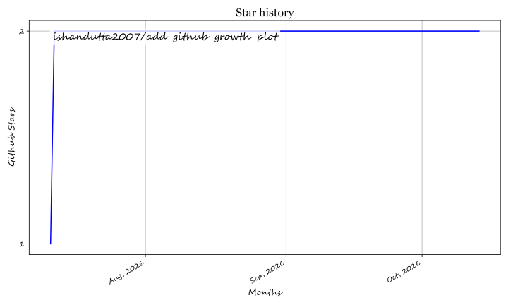

<div align="center">
  
</div>

# 📈 GitHub Stargazers Growth Plotter

<div align="center">

<a href="https://github.com/ishandutta2007/Awesome-Awesome-Awesome"></a><a href="https://discord.gg/jc4xtF58Ve"></a>
[](https://python.org)
[](https://cli.github.com/)
[](https://matplotlib.org/)
[](https://opensource.org/licenses/MIT)
<a href="https://github.com/ishandutta2007"></a>

</div>

> **Note:** As the stargazers API for 3rd party repos gets deprecated or restricted, repository owners can use this tool to easily fetch and publish their own repository's growth charts!

🚀 **GitHub Stargazers Growth Plotter** is an automated tool that fetches the stargazers history of any GitHub repository, caches it locally, and generates a stunning SVG growth plot. Designed for repository owners, this script can auto-publish charts directly to your `README.md` for maximum visibility and better SEO indexing of project metrics.

---

## 📖 Table of Contents
- [👤 End Users Guide](#-end-users-guide)
- [👩‍💻 Developers & Contributors Guide](#-developers--contributors-guide)
- [🚀 Package Publishers & DevOps Guide](#-package-publishers--devops-guide)
- [💖 Support](#-support)

---

## 👤 End Users Guide

### ✨ Features
- 🔐 **Automated Authentication**: Seamlessly integrates with your active GitHub CLI (`gh`) token. Zero manual token configuration required!
- 🎯 **Zero-Config Context**: Automatically detects your current repository from your git config if run without arguments.
- 🗄️ **Local Caching**: Caches historical stargazer data in a CSV file and dynamically appends it to your `.gitignore` to prevent accidental commits.
- 📊 **High-Quality Plotting**: Renders beautiful, scalable vector `.svg` plots optimized for web display, saving them cleanly in an `assets/` directory.
- 📝 **Auto-Publishing**: With a simple flag, automatically inject your latest growth chart into your `README.md` within a perfectly centered HTML block.

### 🛠️ Prerequisites
1. **Python 3.x**: Ensure Python is installed on your system.
2. **GitHub CLI (`gh`)**: You must have the GitHub CLI installed and authenticated.
   ```bash
   gh auth login
   ```
3. **Installation**:
   Install the tool via PyPI:
   ```bash
   pip install github-growth-plotter
   ```

### 🚀 Quickstart
#### 1️⃣ Run for the current repository
```bash
github-growth-plot
```
Detects the repository, downloads stargazers history to CSV, and outputs the SVG plot in `assets/`.

#### 2️⃣ Run for a specific repository
```bash
github-growth-plot "google/jax"
```

#### 3️⃣ Auto-publish to README
```bash
github-growth-plot --publish
```

---

## 👩‍💻 Developers & Contributors Guide

For details on local development, repository structure, and guidelines for opening pull requests, please refer to our dedicated **[CONTRIBUTING.md](file:///C:/Users/ishan/Documents/Projects/add-github-growth-plot/CONTRIBUTING.md)** file.

---

## 🚀 Package Publishers & DevOps Guide

### 📦 Automated PyPI Publishing Pipeline

This repository is configured with an automated CI/CD pipeline via GitHub Actions ([`.github/workflows/publish-pypi.yml`](file:///.github/workflows/publish-pypi.yml)).

#### How Automated Releases Work:
1. **Automatic Trigger on Version Change**:
   Whenever a push is made to the `main` branch that modifies `pyproject.toml` (or any `*.toml` file), `setup.py`, or `github_growth_plotter/__init__.py`, the publishing workflow runs automatically.
2. **Tag Trigger**:
   Pushing git tags matching `v*` (e.g. `v0.1.2`) will also trigger the PyPI deployment.
3. **Automatic Skip for Existing Versions**:
   The deployment uses `twine upload --skip-existing dist/*` to prevent pipeline failures if a commit updates `.toml` files without incrementing the version string.

#### Required GitHub Secrets & Setup:
To enable PyPI publishing for this repository:
- Navigate to **Settings > Secrets and variables > Actions** in your GitHub repository.
- Add a new repository secret:
  - **Name**: `PYPI_API_TOKEN`
  - **Value**: Your PyPI API Token (starts with `pypi-`).

#### Required Personal Access Token (PAT) Scope:
If pushing changes to `.github/workflows/` files using a GitHub PAT via CLI/Git, ensure your token includes the **`workflow`** permission scope:
- **Scope required**: `workflow` (*"Update GitHub Action workflows"*).

#### SaaS Products & API Limits

| SaaS Product | Pricing Model | Free Tier Details / Limits |
| :--- | :--- | :--- |
| **GitHub Actions** | Freemium | 2,000 build minutes/month free for public repositories & free accounts. |
| **PyPI (Python Package Index)** | Free | Free hosting for open source Python packages. |
| **GitHub API** | Freemium | Free for public/private repos. Unauthenticated: 60 requests/hr. Authenticated (via `gh` CLI): 5,000 requests/hr. |
| **GitHub Sponsors** | Free | 0% platform fee for individual developer sponsorships; 100% of sponsorship reaches maintainer. |

---

## 📂 Generated Files

- 🖼️ **`assets/<username>_<reponame>_growth.svg`**: Vector graph of star growth.
- 📄 **`<username>_<reponame>_stargazers.csv`**: Historical star data (ignored by `.gitignore`).

## Star History

<a href="https://star-history.com/#ishandutta2007/add-github-growth-plot&Timeline" align="center">
  <picture>
    <source media="(prefers-color-scheme: dark)" srcset="assets/ishandutta2007_add-github-growth-plot_growth.svg">
    
  </picture>
</a>

---

## 💖 Support

Thank you for using and supporting **GitHub Stargazers Growth Plotter**! Your support keeps this project active, maintained, and continuously improved.

If you find this project valuable, please consider supporting it:

- ⭐ **Star this repository**: Helps more developers discover the tool.
- 🍴 **Fork & Contribute**: Submit PRs, report bugs, or suggest new features in issues and discussions.
- 📢 **Share**: Tell your fellow developers, teams, and open source communities.
- ☕ **Buy me a coffee**: Support ongoing open source work directly via the [GitHub Sponsor Dashboard](https://github.com/sponsors/ishandutta2007).

<div align="center">

<a href="https://github.com/sponsors/ishandutta2007">
  
</a>
<a href="https://github.com/sponsors/ishandutta2007">
  
</a>

</div>

---
*Made with ❤️ for Open Source Maintainers.*
